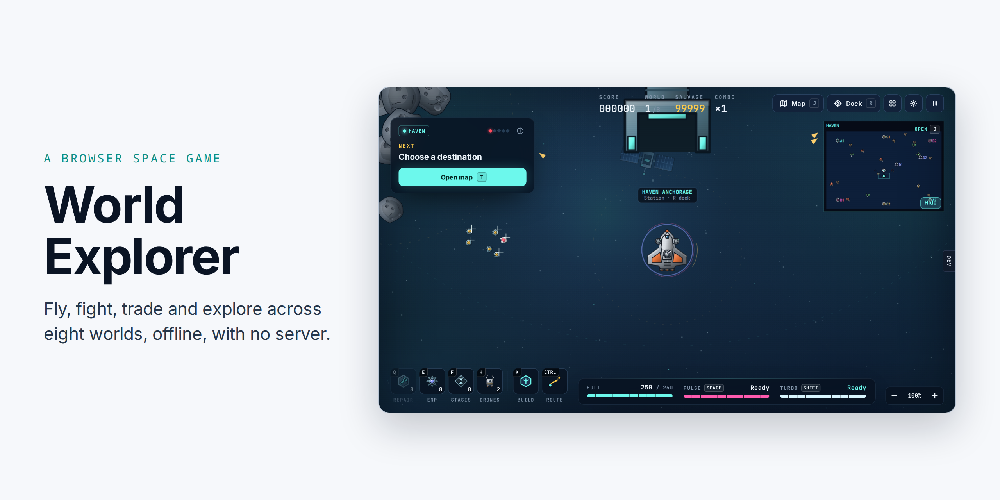

<picture>
  <source media="(prefers-color-scheme: dark)" srcset="img/cover-dark.png">
  
</picture>

# World Explorer

A space flight, trade and exploration game: eight worlds, six ship classes, story chapters and frontier expeditions, offline, with no server.

[Website](https://vbarbarosh.github.io/space-worlds-game/)

## Quick start

    bin/configure
    bin/run

## Documentation

[The full documentation](https://vbarbarosh.github.io/space-worlds-game/),
built from [docs/](docs/README.md) (Settings → Pages → Source: GitHub Actions
turns it on). The rules the game keeps everywhere (what is solid, and the
like) are in [docs/principles.md](docs/principles.md).

Three modes:

- **Arcade**: one run through the eight worlds, three waves each, the world's
  flagship in the third. Raiders come in squadrons; elites lead some of them,
  from Haven on (from the second world on Chill); in the middle worlds a
  squadron fans out round you, and marksmen aim where you will be, a dashed
  line showing their aim; a share of the squadrons fly mixed, and each
  world's elites have a trick of their own. Each world's flagship is a fight
  of its own: its own attacks, each shown before it lands, its own way of
  moving, a second half below 50%, and moments its hull is exposed; it calls
  escorts at 66% and 33%. A ship that explodes hurts what is close to it. The salvage you collect buys
  repairs, weapons, ships, supplies and modules at the station's depot (R); each world opens more of them, and
  what is not open yet says where it opens. A cleared world pays a fixed bonus, the weapon
  grows a tier, a cleared screen shows the world's numbers, and the depot opens before the next world. Score, combo and a best score (salvage left at the end scores 10 points each); no
  stations or contracts. A save keeps the score, salvage and gear, and loading
  it starts its world again from the first wave.
- **Races**: ring races alone, at Easy, Normal or Hard, course after course
  from Haven through the eight worlds; the start ship, no raiders, the rocks
  as solid as ever. Two kinds: Steer, flown by hand, and Turbo, where the
  ship rides a track by itself and you only press and let go of the turbo
  (too fast in a bend, it spins off). After each: your place and time, then race again, the
  next course or the menu. Nothing is saved; the play log records each race
  ([docs/goals.md](docs/goals.md#the-races-mode)).
- **Campaign**: the stations, contracts, trading and story chapters; see
  [docs/scenario/](docs/scenario/README.md). Ranks license ships and guns, and
  each world reached opens more ships, guns and module levels, as in the arcade
  ([docs/balance.md](docs/balance.md), What each world opens).

## Commands

    bin/configure    install dependencies and build
    bin/run          build and open build/index.html in the browser
    bin/build        write build/index.html, build/dev.html and build/agent.html
    bin/captain      the agent's game window and its commands (see below)
    bin/layout-check every screen at twelve window sizes, the menu, the
                     station, the flight HUD and the arcade's cleared
                     screens at three phone sizes too (two upright, one on
                     its side): no HUD
                     block over another, no button off the window or over
                     another, no text cut; shots and report.json in
                     data/layout-check/, exit 1 on a failure
    bin/build-docs   docs/ as a website in build/docs, with the game from
                     bin/build in play/; published to GitHub Pages on every
                     push to main (.github/workflows/docs.yml)
    bin/perf         frame times, garbage and drawing costs over 49 scenes
                     (every world calm and in a fight, zoom 100% and 50%,
                     the arcade from Ion Reach on, campaigns of 10, 50 and
                     100 structures, a ring race and drifting debris close
                     by in Haven and Eclipse), at
                     any window size, pixel ratio and difficulty; see
                     docs/performance-2026-10-05.md
    bin/playtest     a bot plays arcade runs on a virtual clock (about a
                     minute each) and counts per world and wave the hull
                     lost, kills off the screen and salvage left; tables
                     and JSON in data/playtest/
    bin/play-log     a play log saved from the pause panel (Download play log)
                     as a report: time, income and spending per world, the
                     kit as it changed, when the shop ran out, deaths, frame
                     rate; --charts=dir draws its charts as PNGs; the format
                     is in docs/play-log.md
    bin/lint         the rulebook's linter over src/, docs/assets/ and bin/;
                     see AGENTS.md
    bin/map-check    every world's map, campaign and arcade, against
                     docs/placement.md: no two things R acts on within reach
                     of each other, gates and portals where the rules put
                     them, race courses clear of all of it; exit 1 on a
                     failure

`build/dev.html` is the developer mode: the game with a dev panel. It starts
straight into any world, ship and weapon, and has time controls, cheats,
enemy and target-dummy spawning, live upgrade levels and a sound board. The
scene lives in the URL, e.g. `dev.html?world=3&ship=gunship&weapon=rail`; a world goes by number or file name (`world=ion-reach`).
`&screen=station-arsenal` (or flight, combat, arcade, crowded, pause, menu,
map-plan, ...; the list is in src/js/dev/screen.js) opens that screen with the
panel folded; with `&screen=arcade`, `&wave=2` starts the world at its second wave
(a world goal in every world, e.g. `dev.html?world=dustfall&screen=arcade&wave=2`). `&screen=race` starts a ring race at its start line
(`race-mid` mid-race, `race-finish` over the line; `&race_place=1|2|3|last`,
`&race_long=1`, `&race_left=1`, `&race_raiders=1` for its edge states), e.g.
`dev.html?world=0&screen=race`; `&screen=race-results` shows the Races mode's
results (`&race_level=easy|normal|hard`, `&race_place=1|last`,
`&race_end=wrecked|forfeit`, `&race_crashes=n`, `&race_kind=turbo`);
`&screen=races-turbo` lines up a Turbo race, `races-turbo-mid` puts you on
the turbo two seconds before its tightest bend. `&screen=menu` shows the menu with the scene's
game to continue; `&row=arcade` (or `races`, `load`, `settings`, `controls`) opens that
row, `&slots=1` adds six saved slots (the Load row, and its scene with
`&row=load`), `&save=none` a first launch with no game to continue.
`&kit=start` leaves you only the start ship and gun (and the ones in the
URL), so the HANGAR and ARSENAL show what a later world opens. It keeps
its own storage and never touches the game's save. `&contracts=full` crowds
the station's CONTRACTS (three taken, among them a very long title, and the
longest board offered) and `&cargo=all` puts all eleven goods in the hold for
the CARGO MARKET; `&station=full` puts the station's header and NEXT strip at
their longest (a very long station name, the hold full, salvage in the
millions, the guide's longest step); `&screen=station-intel` opens TRADE INTEL.

The interface is the designer's UI kit (src/css/ui-kit.css): one root,
`.ui-screen`, is a size container, so every layout rule is an `@container`
query and a small window and browser zoom behave the same. Run
bin/layout-check after any change to it.

## An agent as a player

A coding agent such as Claude Code or Codex can play the campaign as your
rival, in its own world and its own window. Open the window on your machine,
then start the agent, inside ai-box or anywhere else that shares this folder:

    bin/captain start
    claude "Read docs/agent/README.md and play World Explorer."

The agent's commands reach the window through `data/agent/cdp.sock`, a socket
in this folder, so no port is opened to the network.

`bin/captain` shows the agent the screen as text and presses buttons and keys
for it; `docs/agent/README.md` is its instructions. The agent keeps a diary of
its decisions in `data/agent/diary.md`; its window and save are its own.

## Layout

The game is one page with one script scope. `bin/build` reads
`src/index.html` and replaces each `<!-- include path -->` line with that
file of `src/`, so the include list there is the load order. A
`<!-- slot name -->` line is empty in the game; `src/dev.html` fills the slots
for the dev page.

    src/index.html   the page shell and the include list
    src/css/         styles, in their original order
    src/html/        body markup: the HUD and one file per overlay
    src/js/          game code, one file per part of the game
    src/js/worlds/   one file per world: map, look, flight rules, expedition, music
    src/js/ships/    one file per ship class: catalog entry and hull profile
    src/js/sfx/      one file per sound effect: its cooldown and its synth calls
    src/sprites/     drawings (SVG): ships in 3d/ (the shaded set), weapons, pickups, worlds/<world>; a
                     `<!-- svgs sprites as sprite_svgs -->` line packs them
                     into the page
    src/dev.html     what the dev page adds into the slots of src/index.html
    src/js/dev/      the dev panel: time, cheats, scenario, one file per tab
    src/agent.html   what the agent's page adds: storage of its own, the captain hook
    src/js/agent/    the captain hook: the game state as JSON and the news

Code: [vbarbarosh/rules](https://github.com/vbarbarosh/rules).

## License

[MIT](LICENSE)
