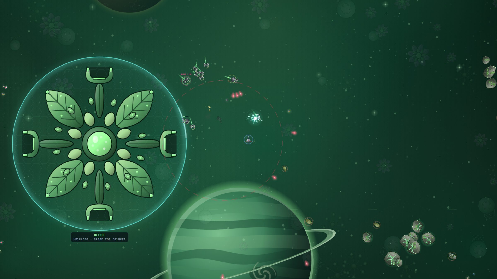
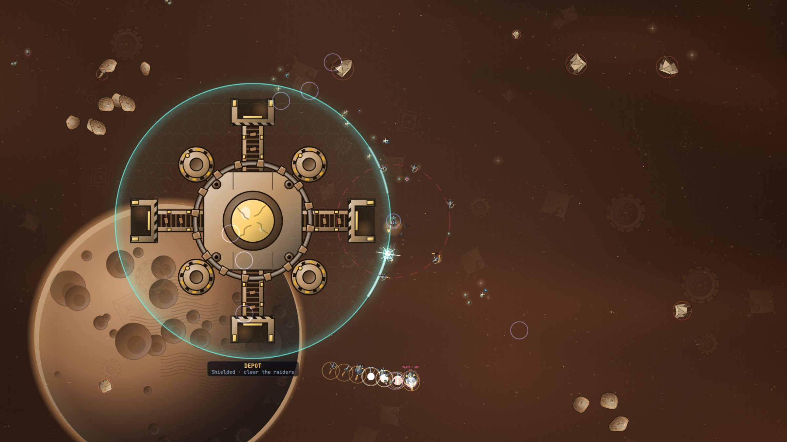
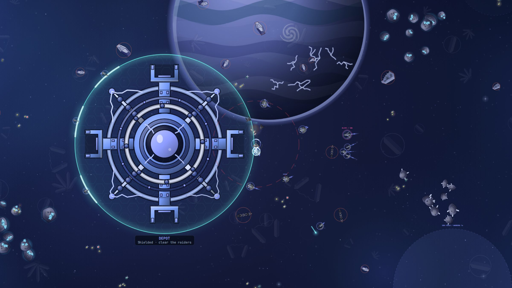
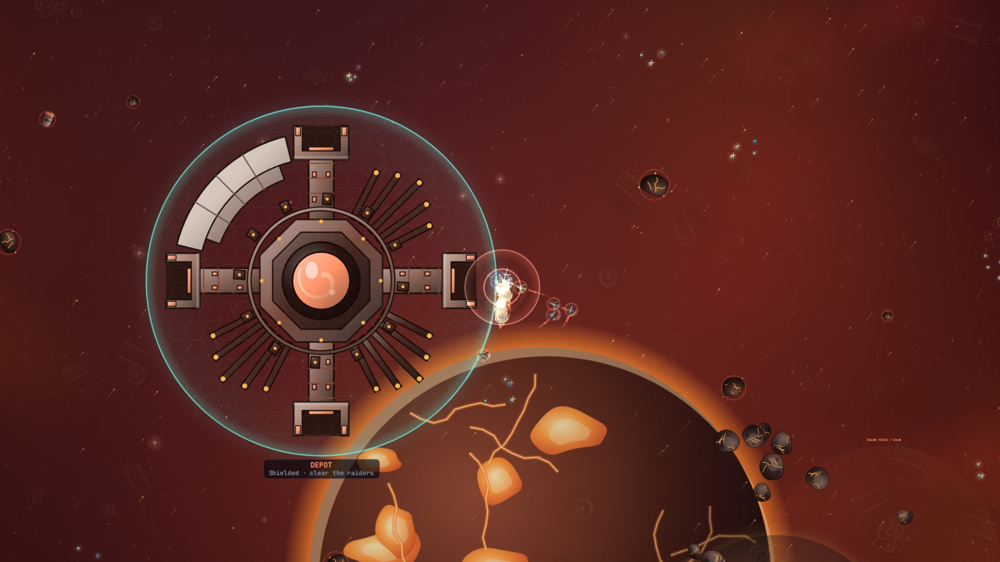
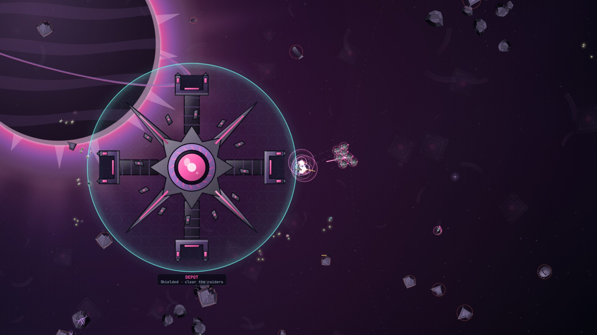

<!-- world: index -->
# The eight worlds

Eight worlds lie between the calm of Haven and the dark of Eclipse, each
with its own sky, its own people and its own flagship. Each is harder than
the one before, and each changes how your ship flies and fights.

- [ **Haven**](haven.md) Blue Shores. A calm ocean world to learn in. Its flagship: the Crescent.
- [ **Verdant**](verdant.md) Living Veil. A green gas giant whose currents carry you. Its flagship: the Thorn Beetle.
- [ **Dustfall**](dustfall.md) Dune Belt. A desert moon in a thick belt of rock, where you drift on and on. Its flagship: the Sawtooth.
- [ **Ion Reach**](ion-reach.md) Electric Storm. Lightning that charges you and drains you. Its flagship: the Storm Wheel.
- [ **Obsidian**](obsidian.md) Iron Expanse. A heavy world of steel and magnetic spires. Its flagship: the Iron Stair.
- [ **Cryosphere**](cryosphere.md) Frozen Aurora. An ice moon where you coast far and shields come back slowly. Its flagship: the Frost Crystal.
- [ **Nova Forge**](nova-forge.md) Solar Foundry. A molten world where your own guns overheat. Its flagship: the Furnace.
- [ **Eclipse**](eclipse.md) Black Crown. The gravity world, last and largest. Its flagship: the Eclipse Eye.

Every picture on these pages is taken from the game itself.
