<!-- world: cryosphere -->
# Cryosphere

Frozen Aurora · the sixth world · home of the Frost Sentinels

[A sky made of glass · Cryosphere's track](cryosphere/music.mp3)

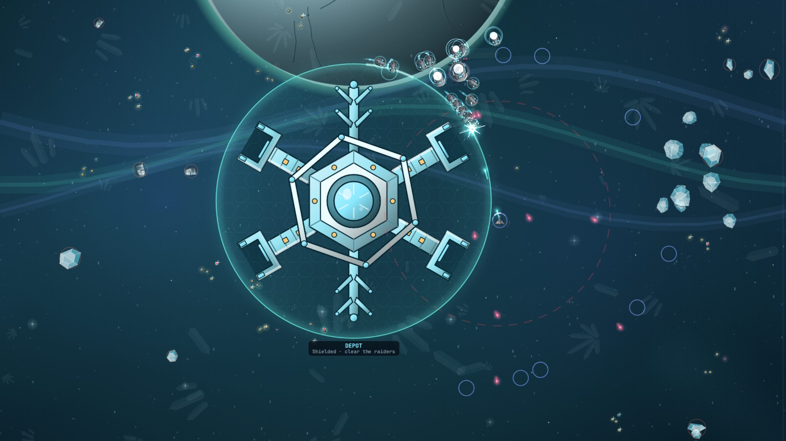

Cryosphere is a fractured ice moon under ribbons of polar light, with
fields of crystal drifting slowly through the cold. It is beautiful and
hard on your ship. In the cold you coast a long way and turn wide, so start
braking before every sharp turn.

The cold has one gift: your cannon fires faster here. Your shields,
though, recover at less than half their usual speed. The Frost Sentinels
carry heavy shields that keep regrowing and fire cryo scatter. In a long
fight it is your armour and your repair kits that keep you going.

## What you find here

- 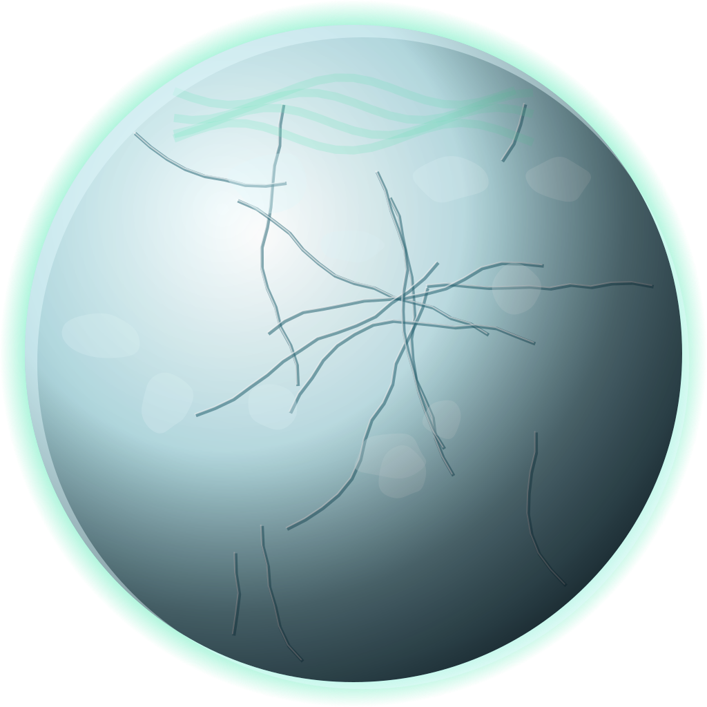 **The moon.** Cracked ice under the aurora.
- 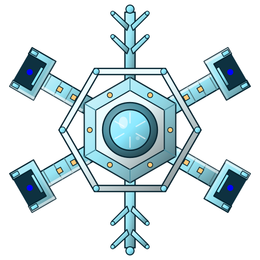 **Glacier Relay.** A research dock shaped like a snowflake.
- 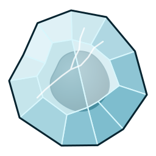 **Rocks.** Ice and stone.
- 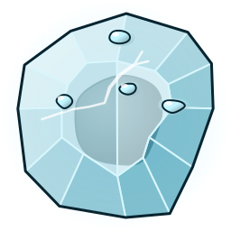 **Rich rocks.** Crystal veins of the world's resource.
- 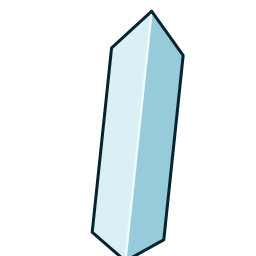 **Crystal fields.** Drifting far behind.
- 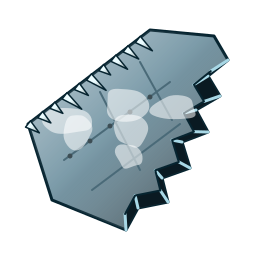 **Wrecks.** Frozen where they stopped.
- 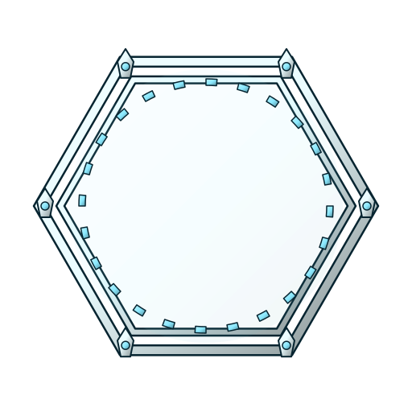 **Portals.** Needed here: the map is huge.
- 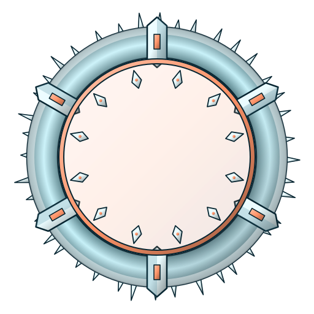 **World gates.** The way on.

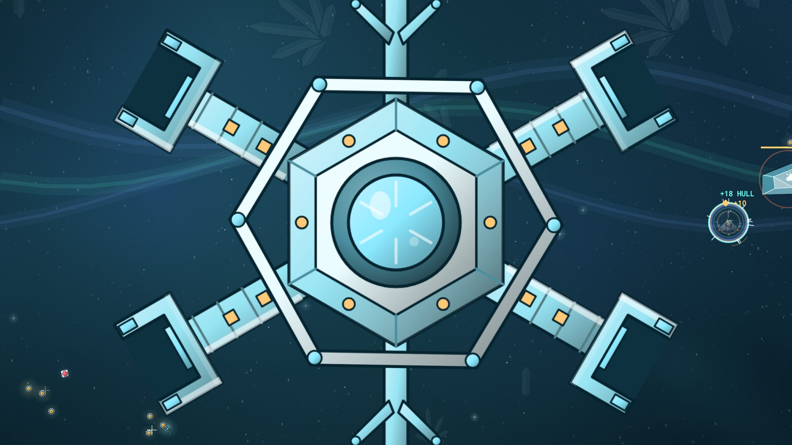

## Who you fight

-  **Raider.** Quick and close.
-  **Tank.** Behind a shield that grows back.
-  **Gunner.** Fires cryo scatter.
-  **Splitter.** Shatters into shards.
- 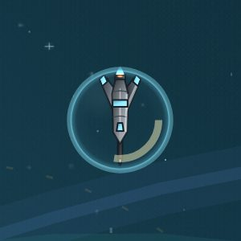 **Lancer.** Lines up and charges.
- 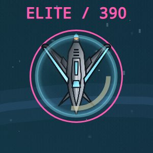 **Elite.** Cryosphere's elites send out a ring of frost that chills you.

## The flagship: the Frost Crystal

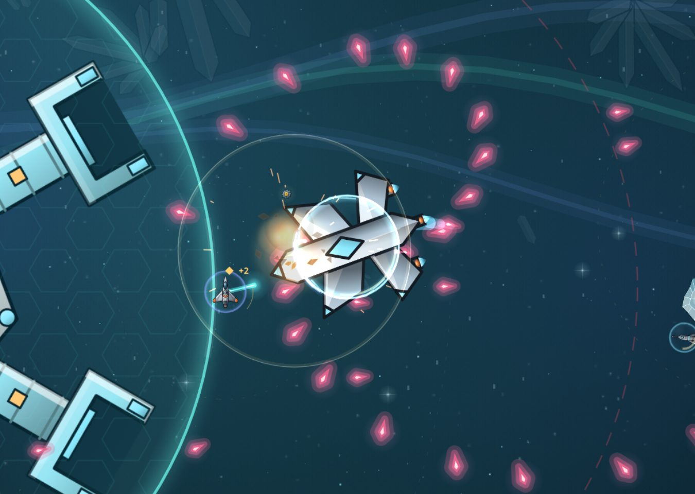

A crystal with a ridge and a diamond core. It glides the way ships do in
the cold. Plates of ice circle it and stop your shots, it spins out shards
and drops icicles, and its frost nova pulls the plates back in close.

In the arcade it can only be hurt while it glows. Hold your fire for those
moments and make them count.

## Before you go

Bring armour and repair nanites, and learn to brake early. Here a fight
is won by lasting, not by shields.
