<!-- world: dustfall -->
# Dustfall

Dune Belt · the third world · home of the Dune Marauders

[Caravan of dust · Dustfall's track](dustfall/music.mp3)

Dustfall is a cratered desert moon in a cloud of amber dust and a belt of
rocks thicker than anywhere else. Gravity is weak, and your ship drifts on
long after you let go of the controls. You learn to turn early, countersteer
and brake. The rocks are worth it: each one you mine gives twice the ore.

Be careful in a fight near a mining field. Here, enemy fire wears the rocks
away. The Dune Marauders fly plated hulls and fire homing missiles, so put
something solid between you and them, while it lasts.

## What you find here

- 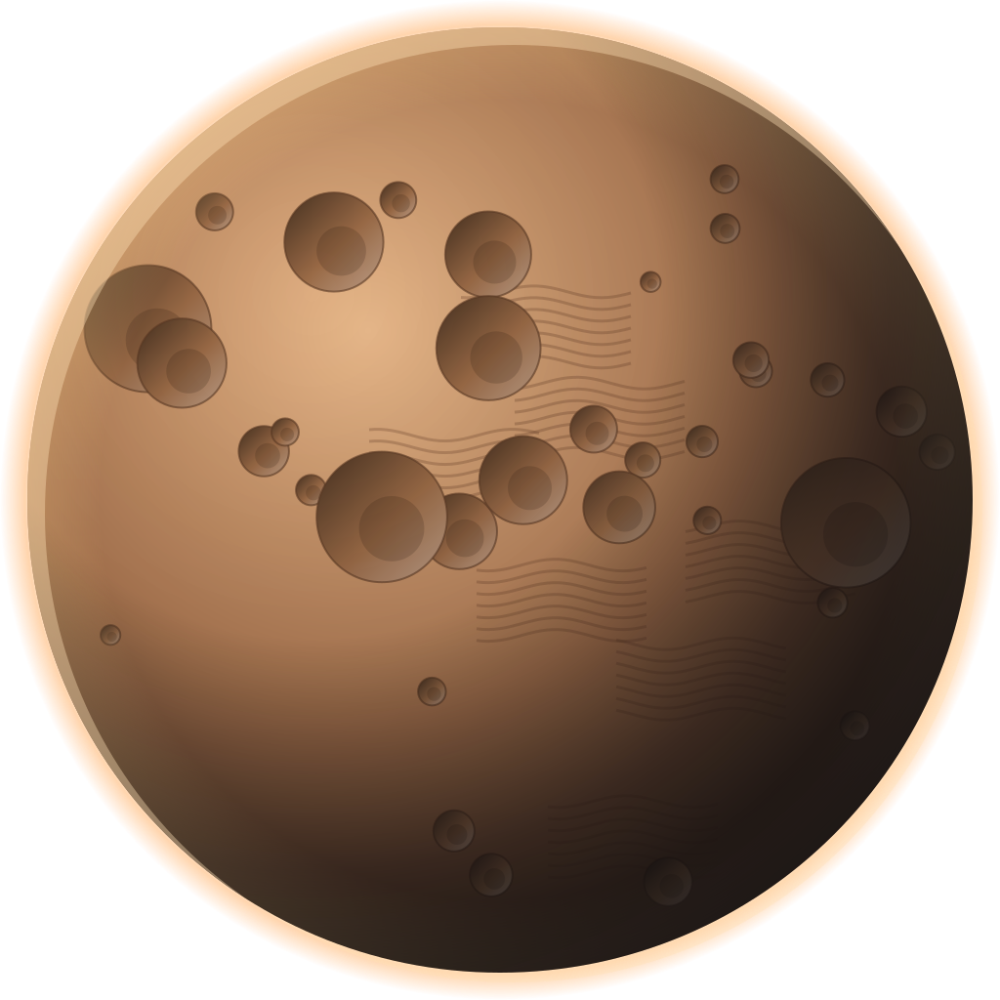 **The moon.** Cratered sand under a hazy amber sky.
- 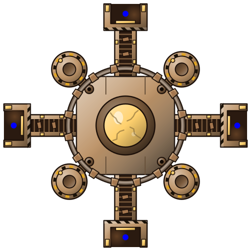 **Dustfall Refinery.** A mining refinery where the belt's ore is sold.
- 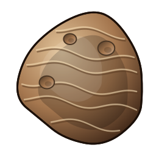 **Rocks.** Everywhere. Each one mined gives two loads of ore.
- 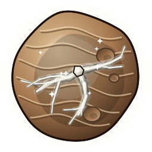 **Rich rocks.** Veined with the world's resource.
- 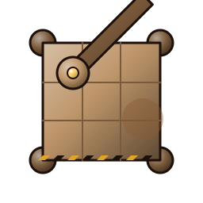 **Dust and stones.** The haze you fly through.
- 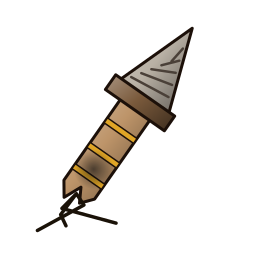 **Wrecks.** Caravans that never arrived.
- 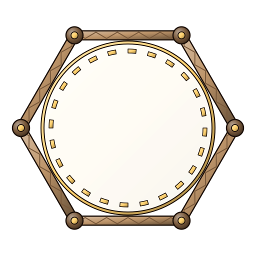 **Portals.** Shortcuts across a big belt.
- 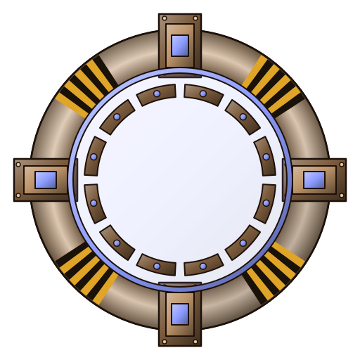 **World gates.** The way on.

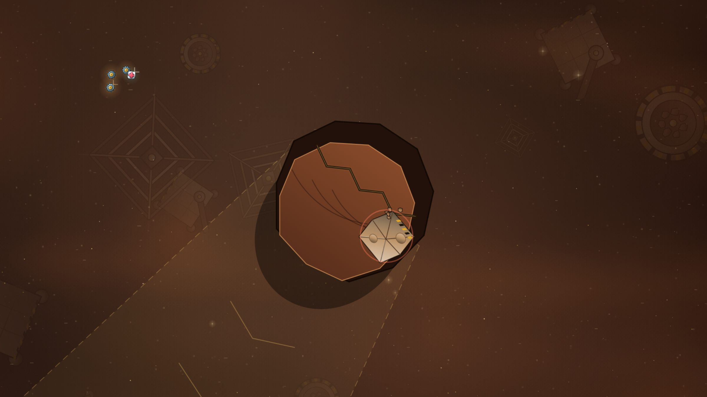

**Cliffs.** In the arcade, great rock faces lean out over the dust, each
over a strip of ground it would fall on. Shoot one down to its crack and it
gives way, crushing whatever is underneath, you included. Lead the raiders
under a cliff and bring it down on them. The rubble becomes new rocks,
closing one way through and opening another.

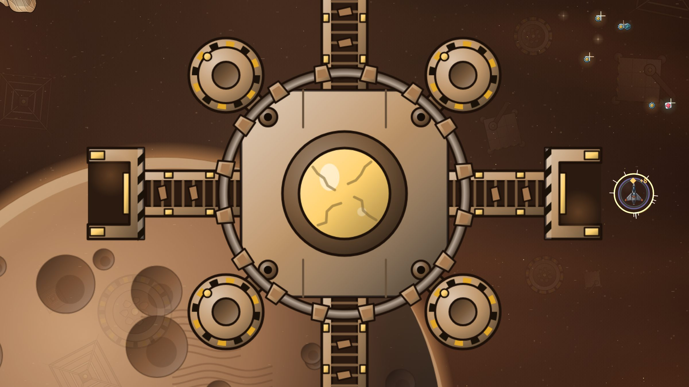

## Who you fight

- 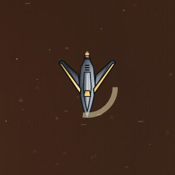 **Raider.** Quick and close.
- 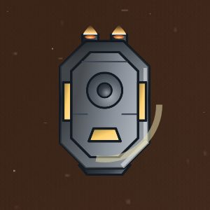 **Tank.** Plated and slow.
- 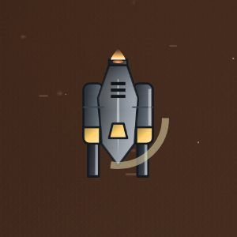 **Gunner.** Fires homing missiles: outturn them.
- 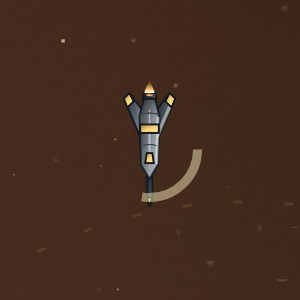 **Lancer.** It lines up and charges straight at you.
- 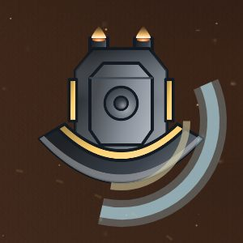 **Bulwark.** In the arcade: its front shield stops your shots. Fly round to its back.
- 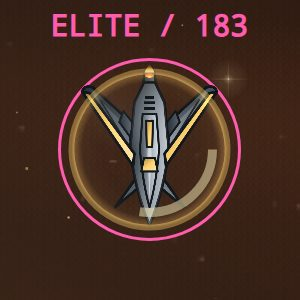 **Elite.** Dustfall's elites charge across your path.

## The flagship: the Sawtooth

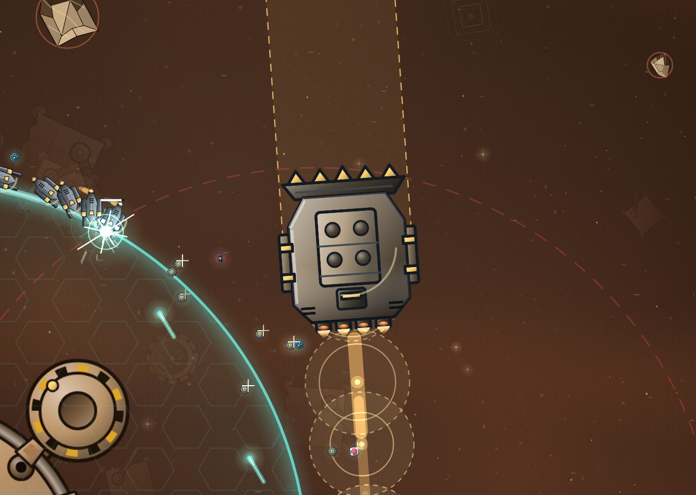

A toothed blade with hatches and pods along its sides. It coasts like
everything here, launches missiles from its hatches and flak from its pods,
then saws straight across you with dust bursting behind it.

In the arcade its charge is its weakness. Stand with a rock behind you and
step aside at the last moment: the Sawtooth hits the rock and stuns itself.
That is your moment to hit back.

## Before you go

Phase armour softens the knocks of flying into rocks, and the phase drive
and the brake help you steer through the belt. Start turning before you
need to.
