<!-- world: eclipse -->
# Eclipse

Black Crown · the last world · home of the Void Armada

Eclipse is the end of the road. The world sits in the shadow of its own
eclipse, ringed by violet light falling into the dark, with broken
monuments of the void drifting through it. It is the biggest map in the
game, so plan your jumps through the portals.

This is the gravity world. Black holes pull more than twice as hard as
anywhere else, and their cores kill you whatever shield you carry. Even a
dash will not save you. Your pulse slowly leaks away, every turbo costs
energy and your magnet reaches less far. The Void Armada fly the
heaviest ships in the game, thick with armour and shields, and fire void
railguns.

## What you find here

- 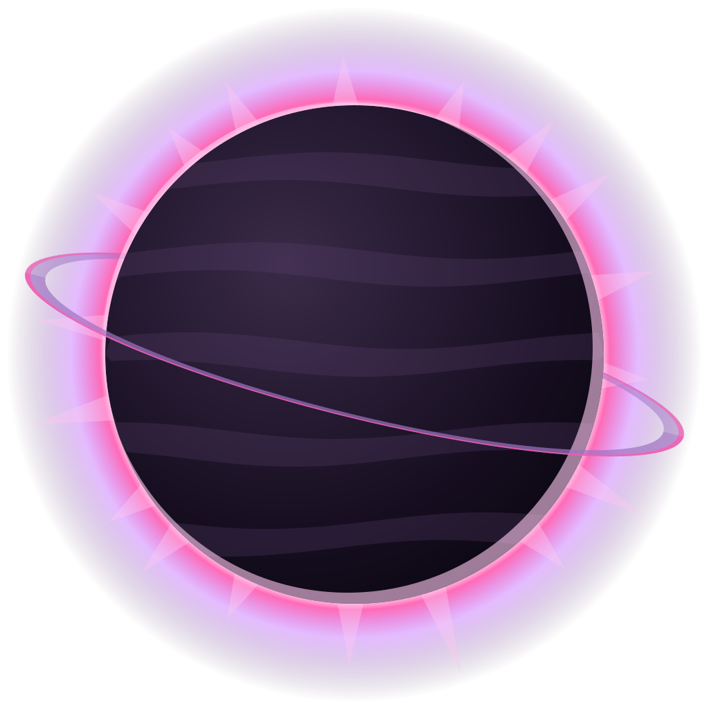 **The planet.** A dark world under a burning ring.
- 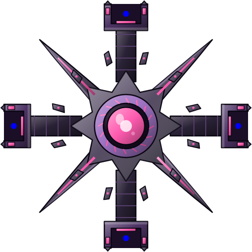 **Last Light Citadel.** A citadel of the void, the last light out here.
- 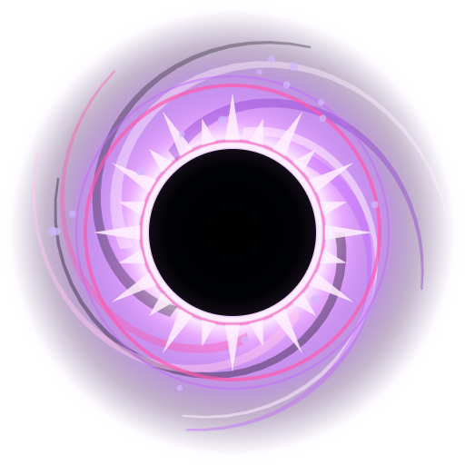 **Black holes.** They bend every shot, sling a ship that passes close and swallow the raiders you lead into them.
- 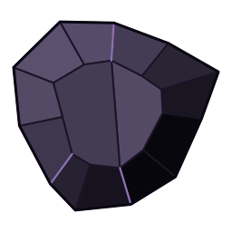 **Rocks.** Dark glass.
- 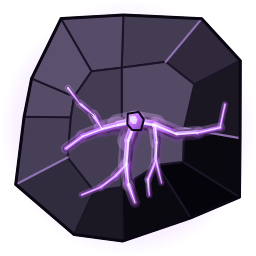 **Rich rocks.** Veined with the world's resource.
- 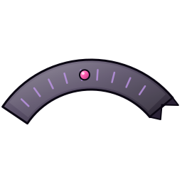 **Void monuments.** Broken shapes drifting far behind.
- 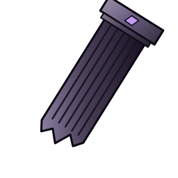 **Wrecks.** The Armada's dead.
- 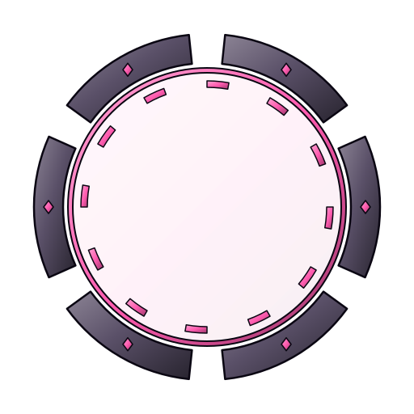 **Portals.** You will need them: the map is 240 by 180 km.

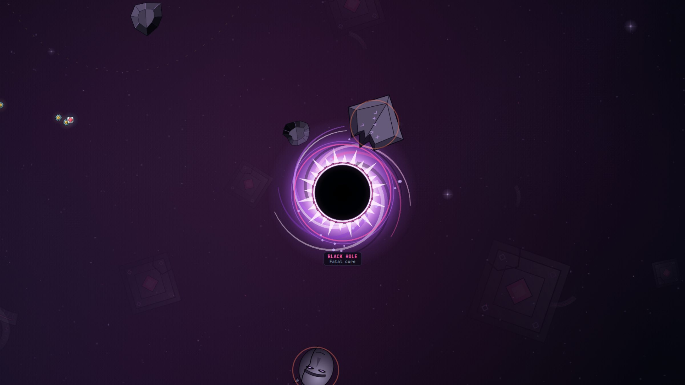

**The black hole.** Its pull bends your shots and the raiders' alike.
Skim its edge to be flung onwards, or lead the raiders close enough that
it takes them. Never touch the core.

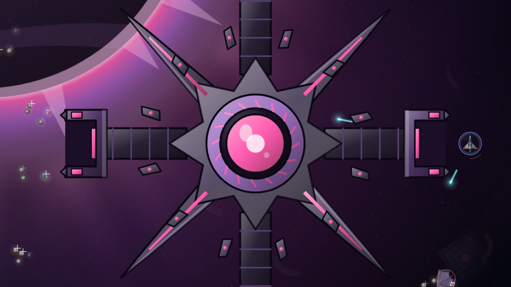

## Who you fight

- 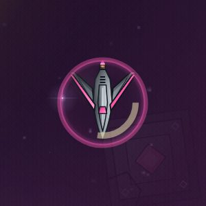 **Raider.** Quick and close.
- 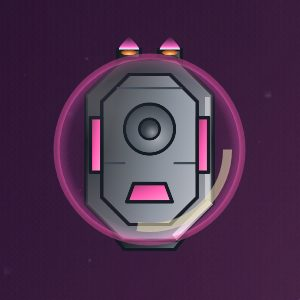 **Tank.** Armour and shield both.
-  **Gunner.** Void railgun slugs.
-  **Splitter.** Breaks into shards.
- 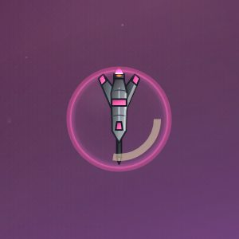 **Lancer.** Lines up and charges.
- 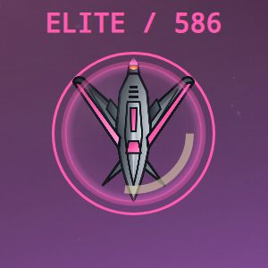 **Elite.** Eclipse's elites jump through the void.

## The flagship: the Eclipse Eye

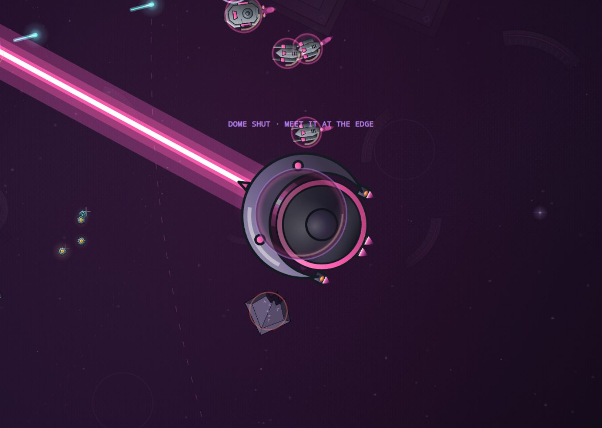

A crescent with a dark eye in a pink ring and a domed core. It jumps
through the void, and its eye beam turns to follow you. It fires fans of
rail lanes, and while its dome is open it opens a singularity that pulls
you in.

In the arcade its dome opens only while you are at the black hole's edge
with it. Fly the edge, hold your nerve, and strike when the dome opens.

## Before you go

Upgrade the pulse reactor, the magnet and the turbo drive. You need at
least 90% radiation protection.
