<!-- world: haven -->
# Haven

Blue Shores · the first world · home of the Rim Corsairs

[Home among the stars · Haven's track](haven/music.mp3)

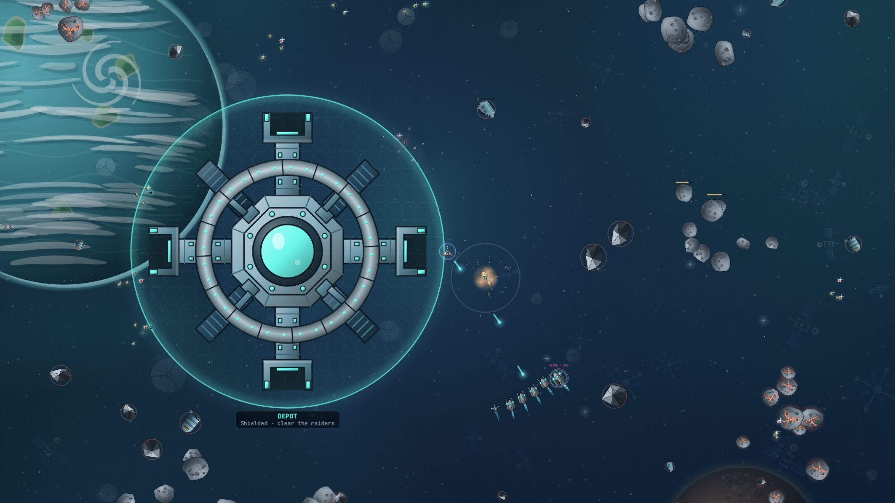

Haven is where every pilot starts, and it feels like a harbour. A blue ocean
planet turns below you, soft nebulae drift across the sky and old
satellites tumble quietly past. Your ship answers the controls at once and
stops the moment you let go, so it is a good place to learn how to fly,
mine and fight.

The Rim Corsairs who raid here are a nuisance more than a threat: light
ships with plasma guns and no armour. Use the calm. Mine, take a few
contracts and get your ship ready before you head out to the harder worlds.

## What you find here

- 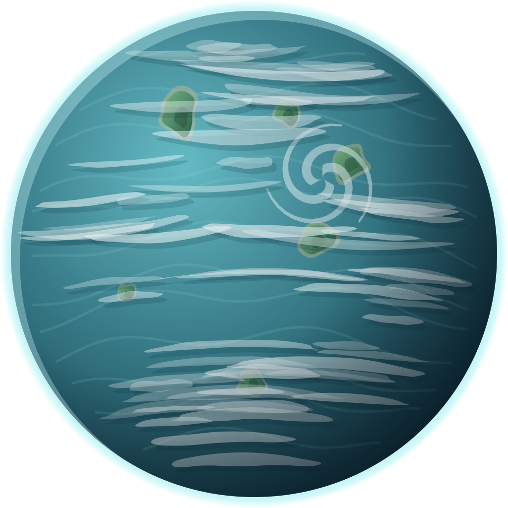 **The planet.** An ocean world under thin clouds.
- 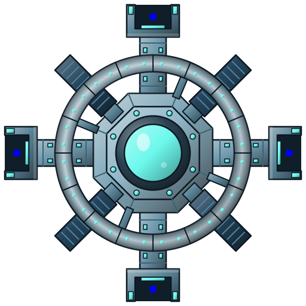 **Haven Anchorage.** An orbital harbour, your base: dock to repair, trade and buy.
- 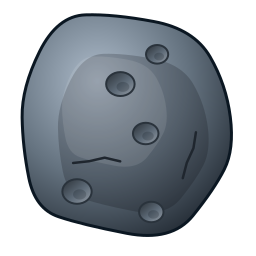 **Rocks.** Mine them for ore. Rocks are solid, so they make cover in a fight too.
- 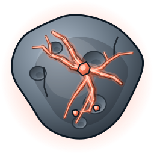 **Rich rocks.** The veined ones hold more, and the world's own resource.
- 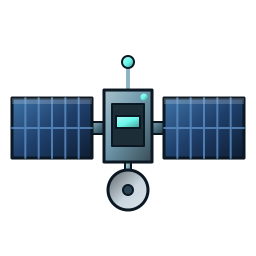 **Satellites.** Old ones, drifting past in the background. Only Haven has them.
- 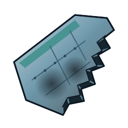 **Wrecks.** Hulls of ships that came before you, floating free.
- 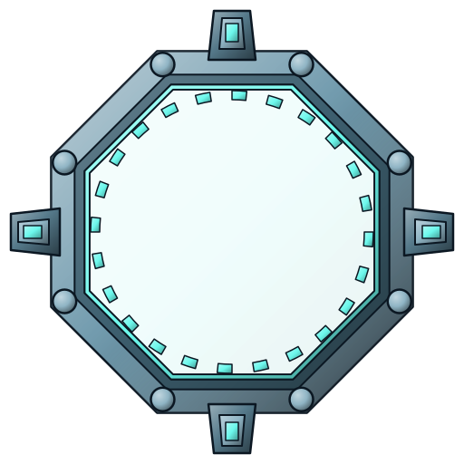 **Portals.** Pairs of gates: fly into one and you come out of the other, far across the map.
- 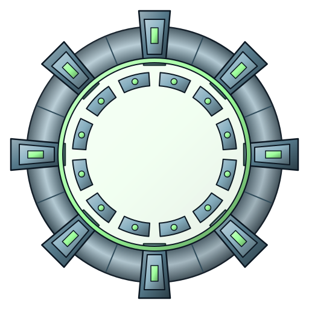 **World gates.** The way on to the next worlds, once your ship is ready for them.
- 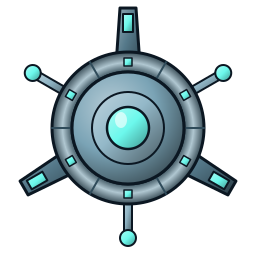 **Beacons.** Where survey and defence contracts send you.

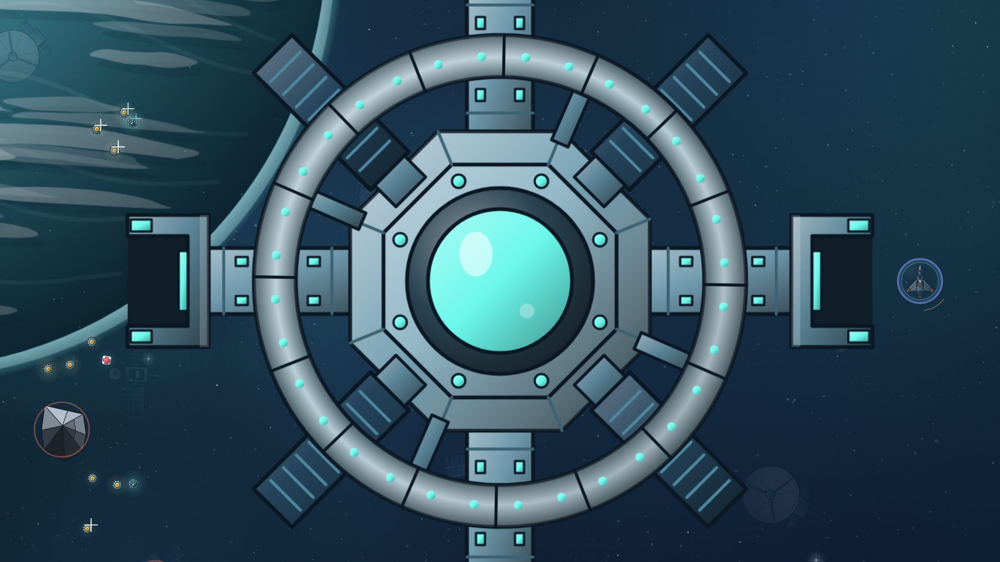

## Who you fight

- 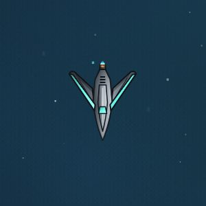 **Raider.** Fast and light, it comes straight at you.
- 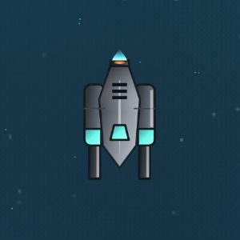 **Gunner.** Keeps its distance and fires plasma at you.
- 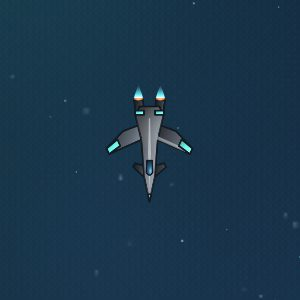 **Interceptor.** In the arcade: it bursts faster than you cruise. Turbo away, or shoot it down.
- 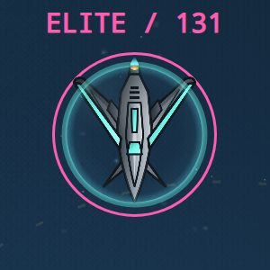 **Elite.** In the arcade, elites lead some squadrons. Haven's fire short fans of plasma.

## The flagship: the Crescent

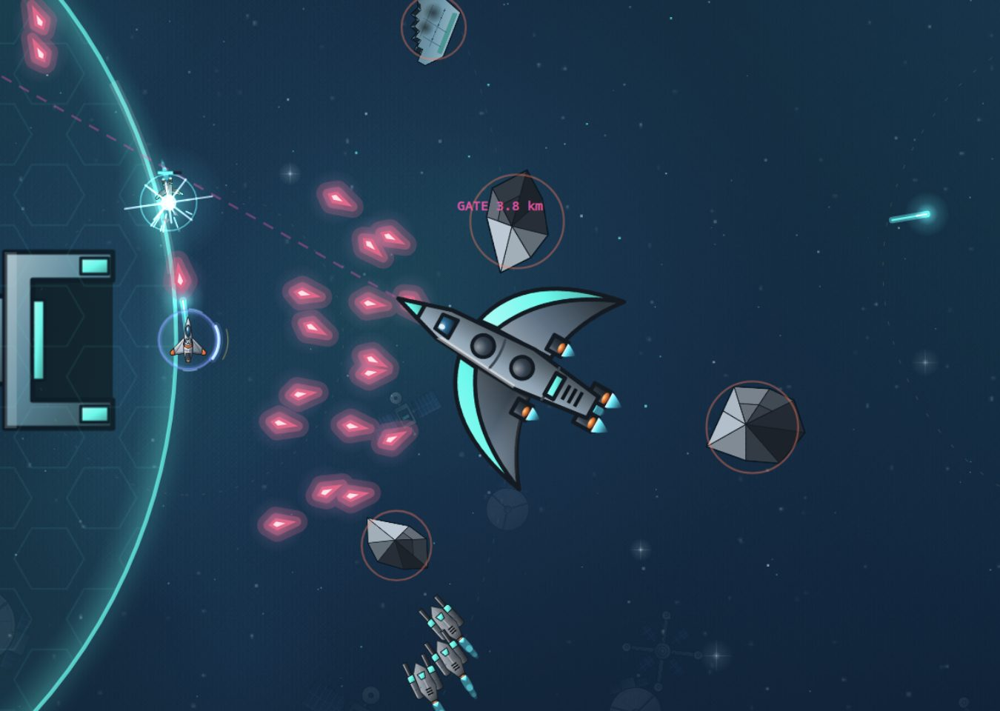

A corsair ship shaped like a crescent moon. It circles you, fans plasma from
its wingtips and cuts across your path in strafing runs. Watch its wings
light up before each fan and slip between the shots.

In the arcade the Crescent is a chase. When it is hurt it runs for a gate,
and if it gets there, it escapes. Stay on its tail and finish it before it
reaches the gate.

## Before you go

Haven forgives mistakes: shields come back faster here and gravity pulls
gently. Spend your time here building up your salvage and your ship. No
other world will be this kind.
