<!-- world: ion-reach -->
# Ion Reach

Electric Storm · the fourth world · home of the Volt Collective

Ion Reach is a storm that never ends. An indigo planet lights up with arcs,
prisms hang in the air and the station turns like a gyroscope. Everything
moves faster here: your shots and the raiders' alike fly a third quicker,
and your shields recover twice as fast once the fight is over.

The storms go in a cycle: calm, a warning, then a discharge. Inside a
discharge your pulse charges very fast, but your shields drain away. That
trade is the heart of this world: step into the lightning to charge up,
then get out before it costs you too much. The Volt Collective fire ion
bolts that drain your pulse, and their shields keep coming back.

## What you find here

- 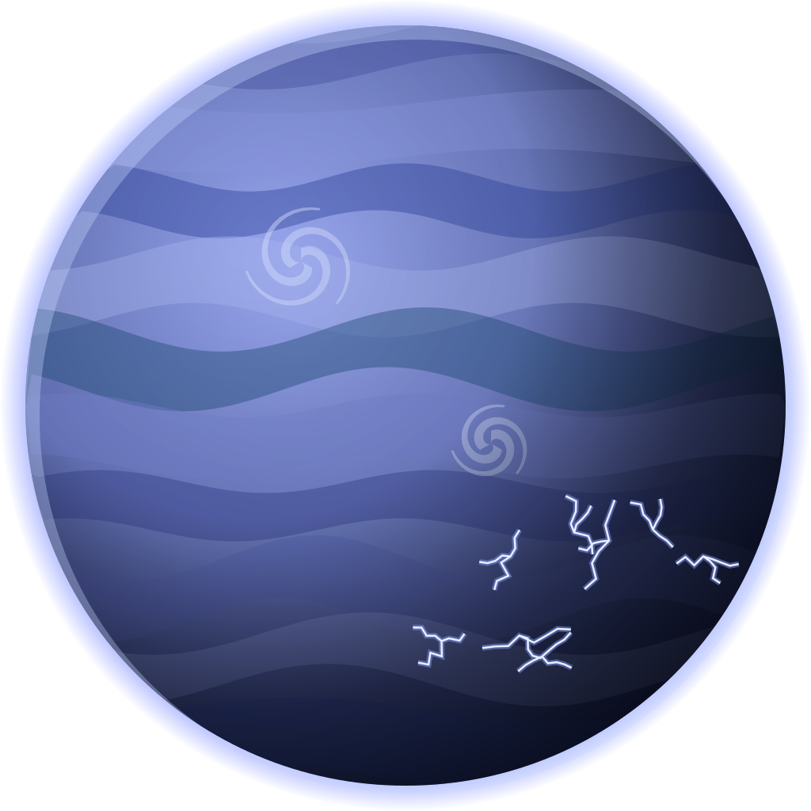 **The planet.** Indigo clouds lit by lightning.
- 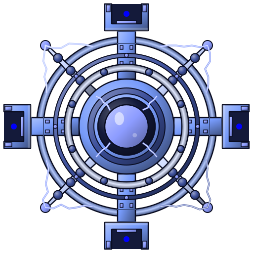 **Arc Spire.** A turning gyroscopic array.
- 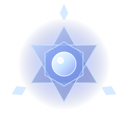 **Arc pylons.** Only here. Fly inside a pylon's ring and a gold ring closes on you: you have about a second to get out before it strikes.
- 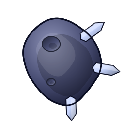 **Rocks.** Charged crystal and stone.
- 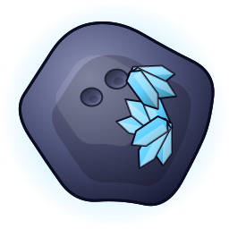 **Rich rocks.** Veined with the world's resource.
- 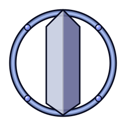 **Prisms.** Hanging in the storm, far behind.
- 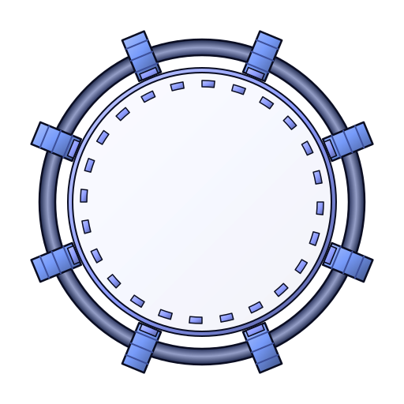 **Portals.** Ways across the storm.
- 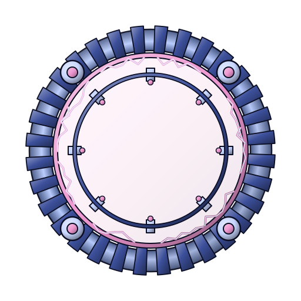 **World gates.** The way on.

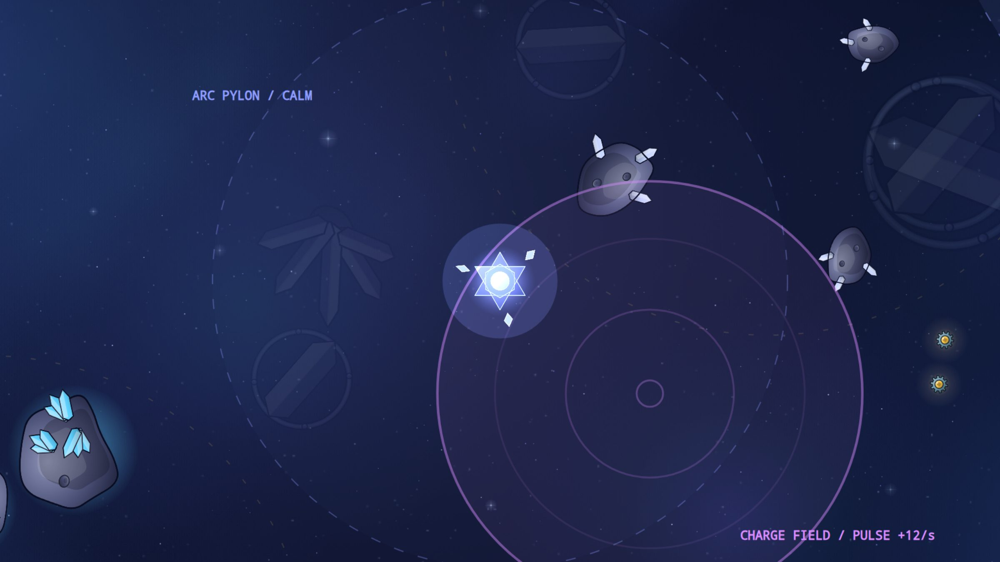

**Arc pylons and charge fields.** Violet charge fields, most of them beside
a pylon, fill your pulse while you stay inside them. The pylon next to them
punishes you for staying too long. Dip in, charge, and get out.

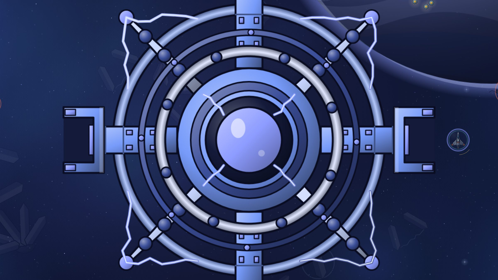

## Who you fight

- 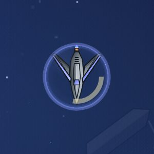 **Raider.** Quick and close.
- 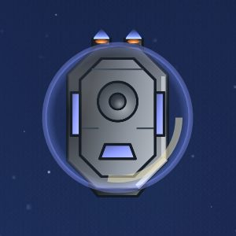 **Tank.** Heavy, its shield regrowing.
-  **Gunner.** Fires ion bolts that drain your pulse.
-  **Splitter.** Breaks into shards when hit.
- 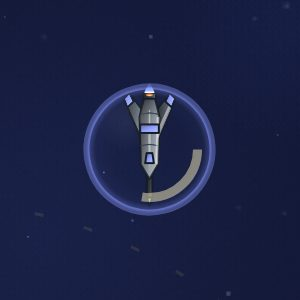 **Lancer.** Lines up and charges.
-  **Sniper.** In the arcade: a red line shows where it is aiming before it fires. Close in, or put a rock between you.
-  **Elite.** Ion Reach's elites jump from place to place.

## The flagship: the Storm Wheel

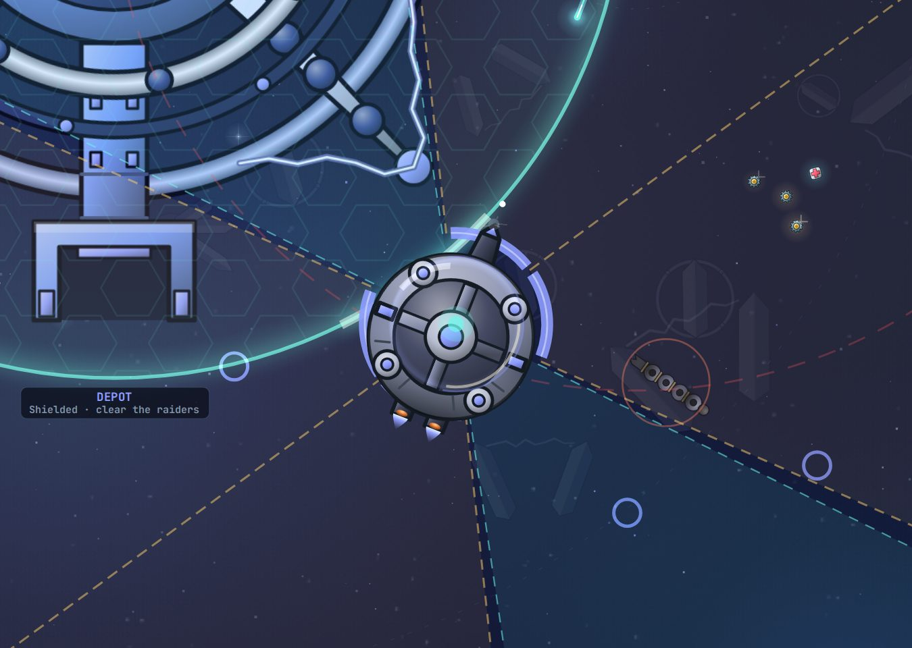

A wheel with a hub and four pods. It keeps its distance, jumps through the
storm and sweeps the space around it with spokes of lightning. Once it is
half broken it sends its pods out to shield the hub.

In the arcade its shell turns, and only the gaps in it let your shots
through. Time your fire to the gaps.

## Before you go

Shield capacitors and pulse reactors let you use the storms instead of
fearing them. Keep an eye on the gold rings. This is the first world with
radiation: fit at least 15% protection.
