<!-- world: nova-forge -->
# Nova Forge

Solar Foundry · the seventh world · home of the Ember Legion

[The sun below · Nova Forge's track](nova-forge/music.mp3)

Nova Forge burns. A molten planet glows below, a blazing corona fills the
sky and embers trail through the air. Here your own guns are part of the
danger. Every shot heats them, and so does the turbo. When the heat is full
the guns lock and stay locked until they cool. Fire in bursts, not in one
long stream.

Marked solar fields warn you, then flare. A flare adds heat and burns a
hull that has no shield left. Radiation is strong too, and ordinary
shields do not stop it. The Ember Legion fire volleys of seeking missiles
and wear thick ablative armour.

## What you find here

-  **The planet.** Molten rock under a burning sky.
- 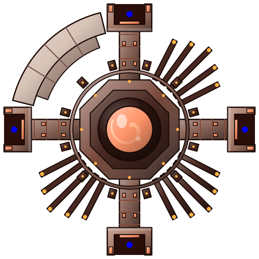 **Helios Foundry.** A forge built to drink the sun.
- 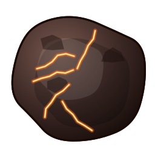 **Rocks.** Scorched and glowing at the cracks.
-  **Rich rocks.** Veined with the world's resource.
- 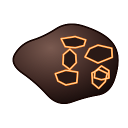 **Volcanic debris.** Thrown up from the planet, drifting behind.
- 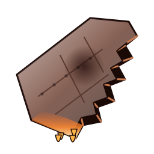 **Wrecks.** Ships that ran too hot.
- 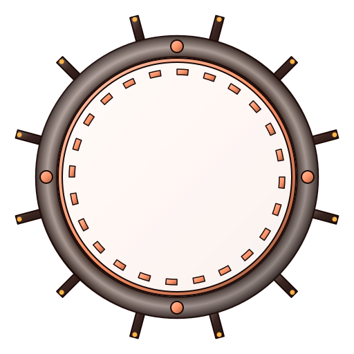 **Portals.** Ways across a big map.
- 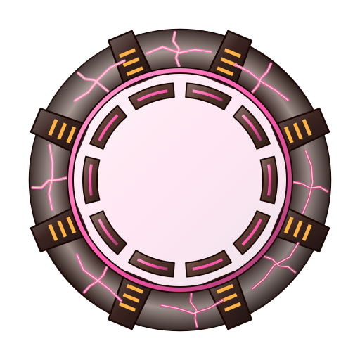 **World gates.** The way on.

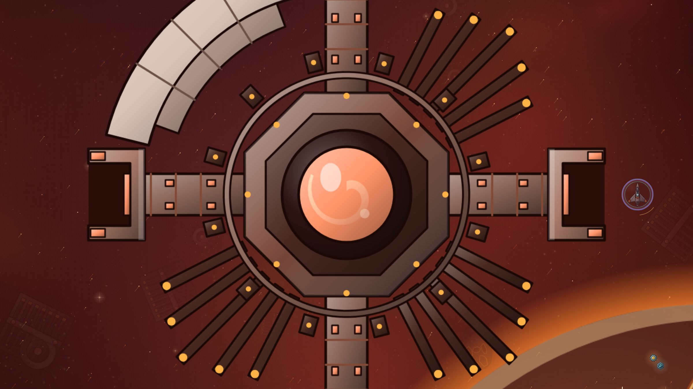

## Who you fight

- 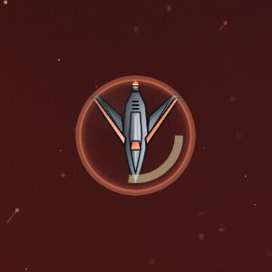 **Raider.** Quick and close.
- 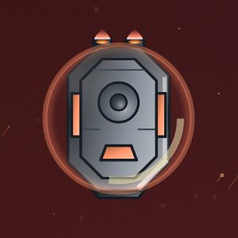 **Tank.** Thick ablative armour.
-  **Gunner.** Fires volleys of seeking missiles.
-  **Splitter.** Bursts into shards.
-  **Lancer.** Lines up and charges.
- 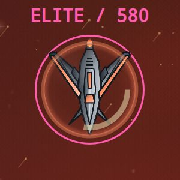 **Elite.** Nova Forge's elites throw embers around you that burst a moment later.

## The flagship: the Furnace

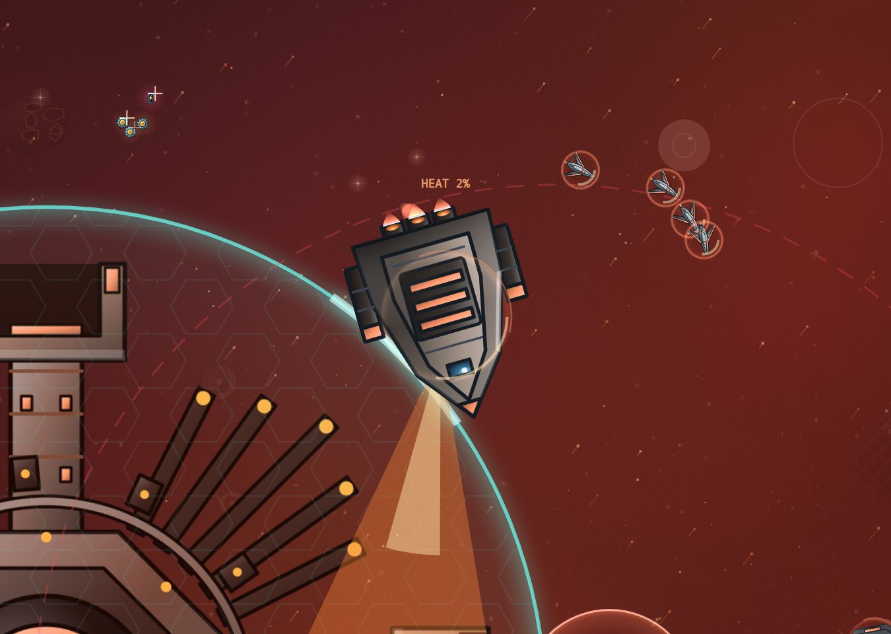

A walking furnace with glowing vents. It lumbers in close and sweeps a
flame from its vents that heats your guns. It lobs embers that leave burning
slag behind and fires missiles. When it flares, the furnace opens.

In the arcade a ring of fire closes in around the fight as the Furnace
heats up. Do not let it drag the fight out.

## Before you go

Pulse reactors and reactor cooling keep the heat down. Radiation here
needs at least 80% lining.
