<!-- world: obsidian -->
# Obsidian

Iron Expanse · the fifth world · home of the Iron Dominion

[Silent machinery · Obsidian's track](obsidian/music.mp3)

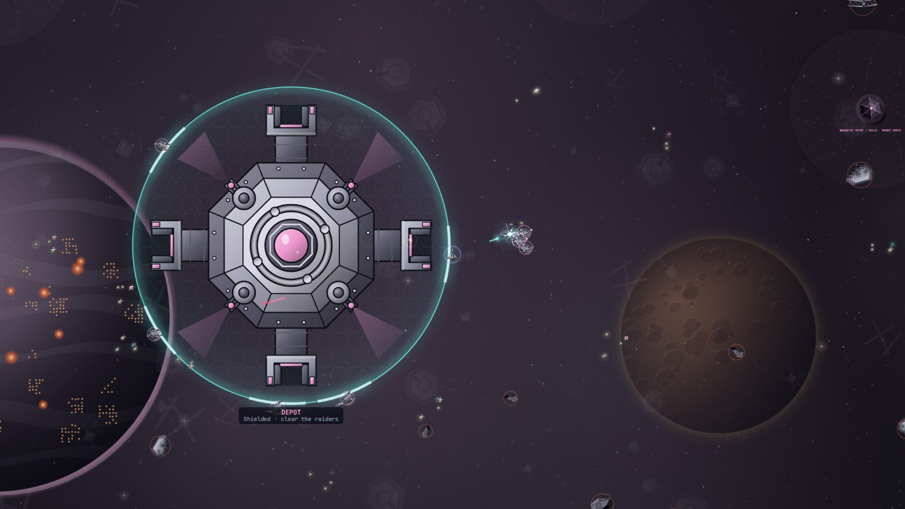

Obsidian is heavy. It is a fortified industrial planet among steel wreckage
and armoured outposts, and you feel its weight in your hands: your ship
cruises slower, your shots fly slower and the planet itself pulls at you.
Black holes here pull much harder than elsewhere.

What helps is cover. Rocks are solid, and the Iron Dominion's railguns
are fast and their armour thick, so a fight here is won from behind
something. The magnetic spires are the best cover of all.

## What you find here

- 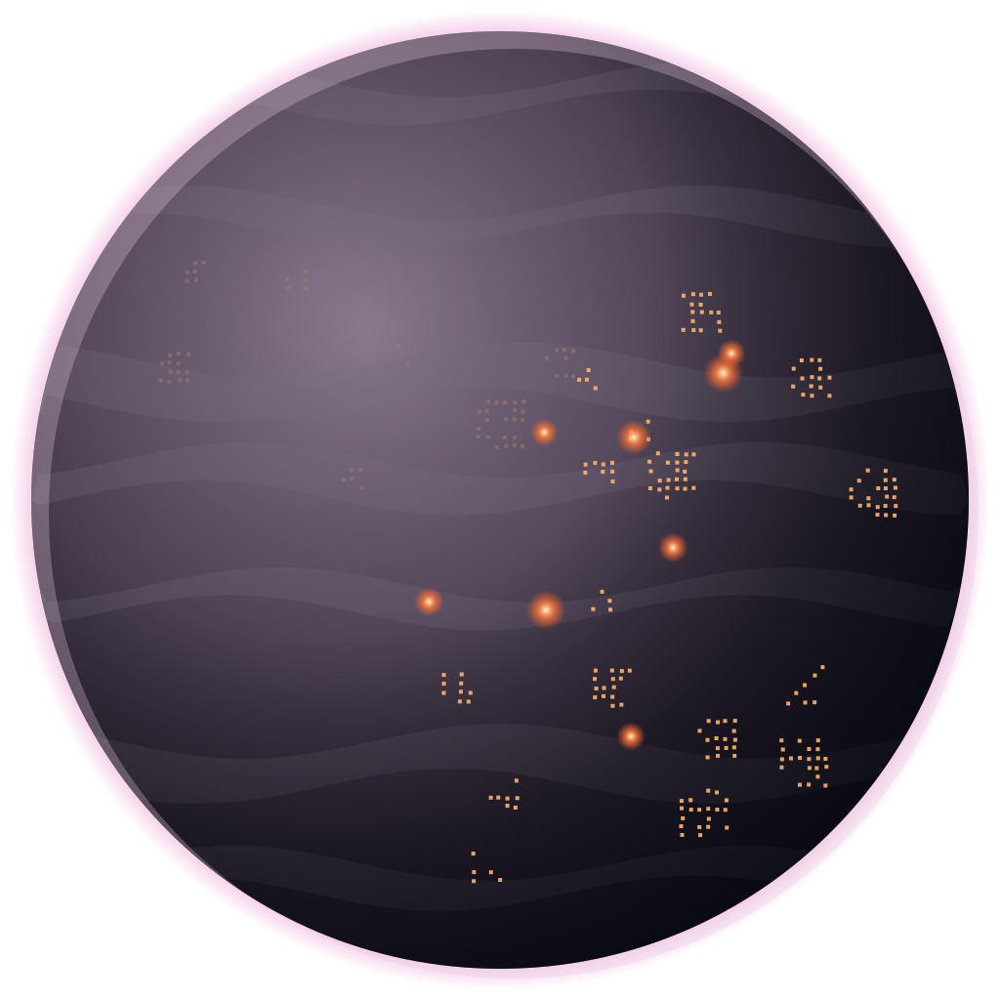 **The planet.** Grey industry from pole to pole. It pulls gently at every ship.
- 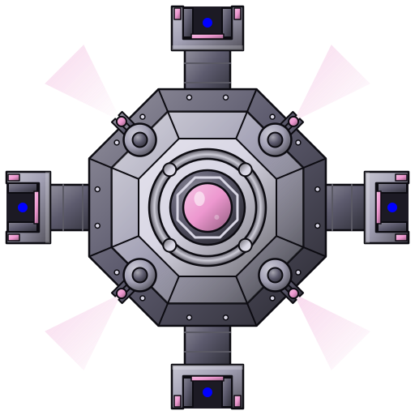 **Bastion Dock.** An armoured bastion.
- 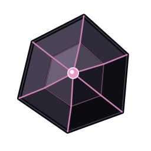 **Magnetic spires.** Only here. They draw ships in and bend passing shots into themselves.
- 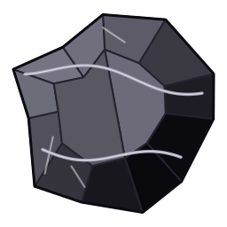 **Rocks.** Hard, solid cover.
- 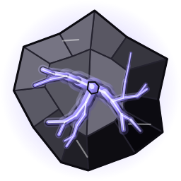 **Rich rocks.** Veined with the world's resource.
- 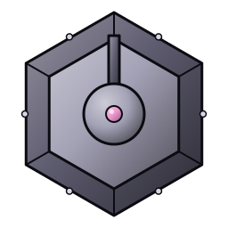 **Steel wreckage.** The remains of old works in the background.
- 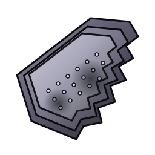 **Wrecks.** Plates and girders adrift.
- 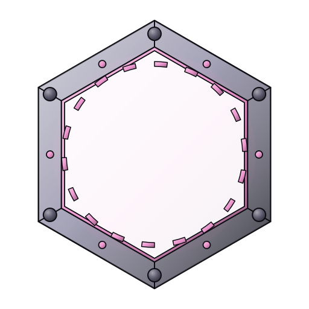 **Portals.** Ways across a vast map.
- 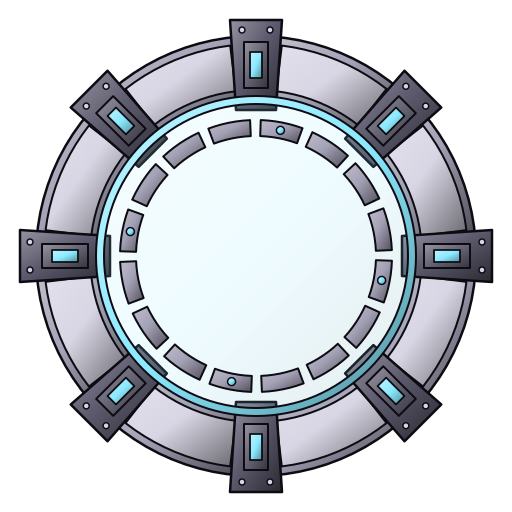 **World gates.** The way on.

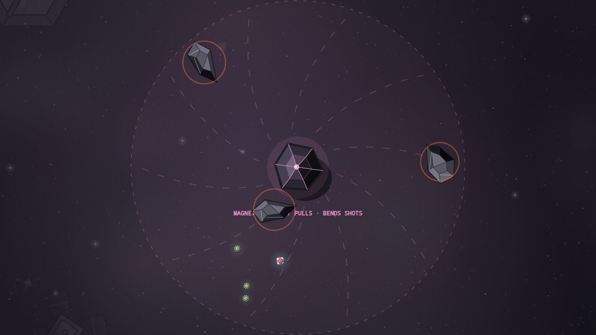

**Magnetic spires.** Within about 280 m a spire pulls ships towards it,
and every shot that passes close bends into it, yours and the raiders'
alike. So keep a spire between you and the guns. Spires are solid, and
nothing can break them.

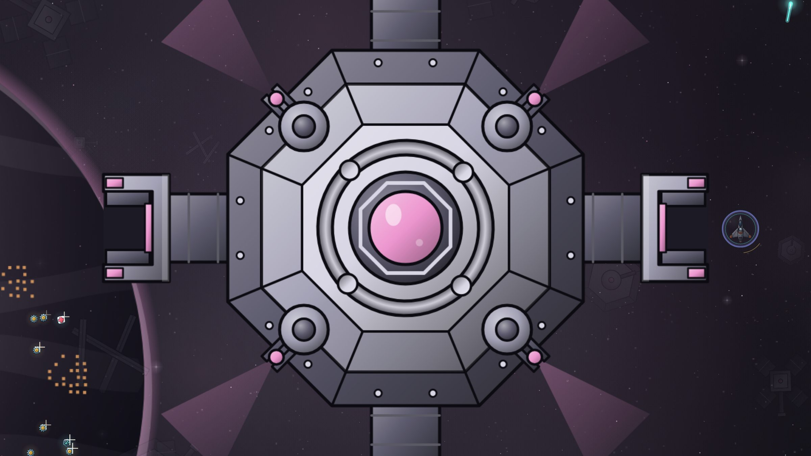

## Who you fight

- 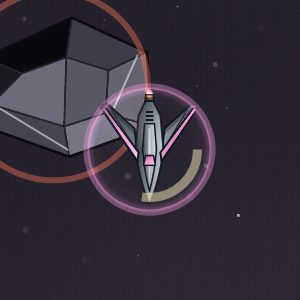 **Raider.** Quick and close, even here.
-  **Tank.** Half its weight is armour.
-  **Gunner.** Fast railgun slugs.
-  **Lancer.** Lines up and charges.
-  **Mine-layer.** In the arcade: it seals the lane ahead of you with mines. Go another way, or clear them with a pulse.
-  **Elite.** Obsidian's elites track you with a rail sight that locks before it fires.

## The flagship: the Iron Stair

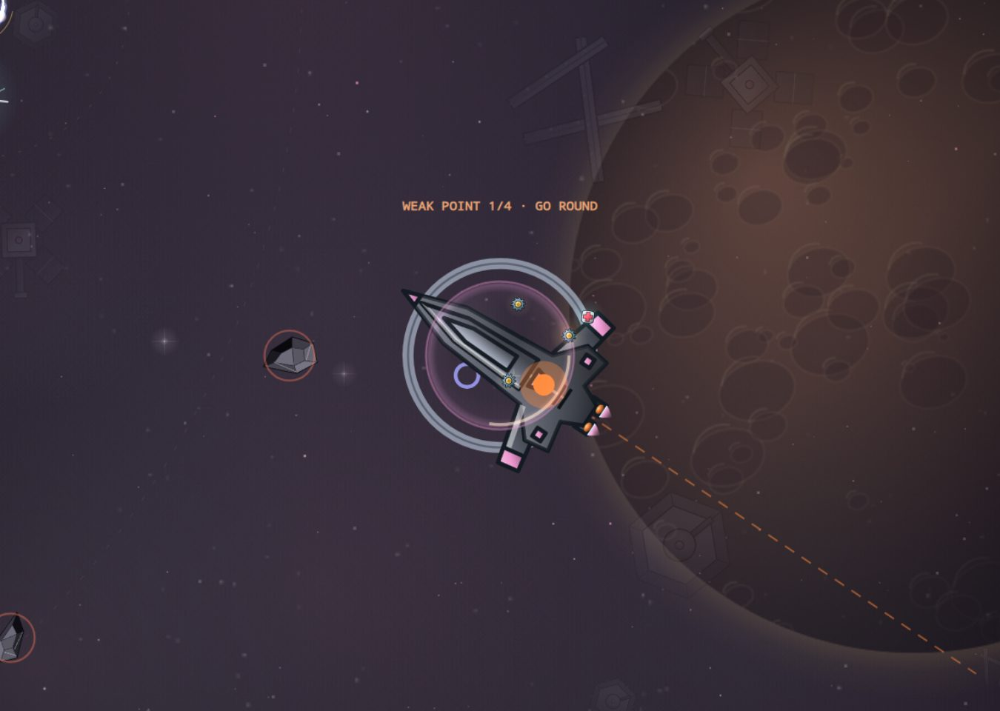

A stepped blade, heavy and slow. It steps forward, tracks you with rail
sights that lock on before they fire, opens gravity wells under you and
turns broadside to fire a whole row of lanes at once.

In the arcade it has weak points, and only one is open at a time. Find the
one that is lit and aim there.

## Before you go

Upgrade Slipstream and phase armour, and fly a hull built for gravity if
you can. Radiation is stronger here: you need at least 30% protection.
