<!-- world: verdant -->
# Verdant

Living Veil · the second world · home of the Thorn Swarm

[The breathing nebula · Verdant's track](verdant/music.mp3)

Verdant is alive. An emerald gas giant fills the sky, spores glow in the
mist and the station grew like a plant rather than being built. Slow
currents run through the nebula, and they push everything along: your ship,
your shots, even the ore you have just broken loose. They change direction
slowly, so read them and let them carry you, or hold the brake to stay put.

The cloud is kind to you, as long as you stay out of a fight: it slowly
mends your hull. The Thorn Swarm who live here fly organic, armoured ships
with scatter cannons. Some of them break apart into smaller pieces when you
hit them.

## What you find here

- 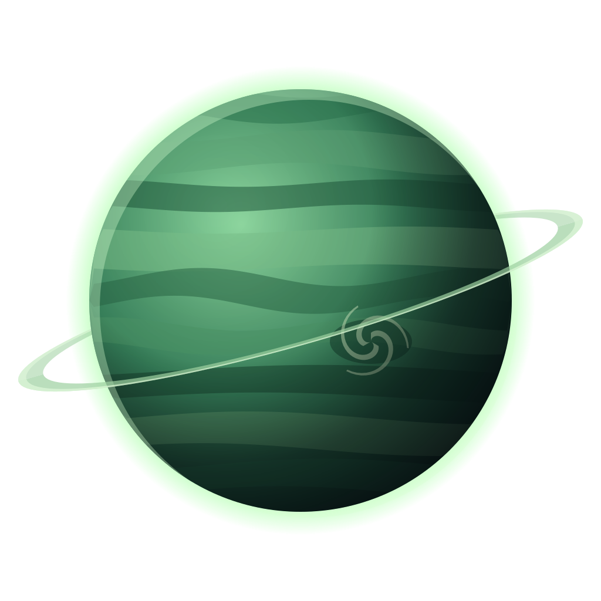 **The planet.** An emerald giant wrapped in rings.
- 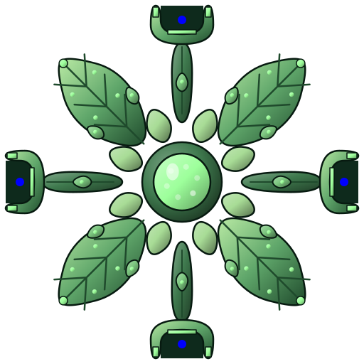 **Canopy Exchange.** A station that grew from leaves and pods, the Swarm's market.
- 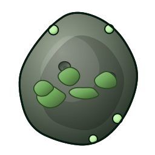 **Rocks.** Overgrown, and they drift with the current.
- 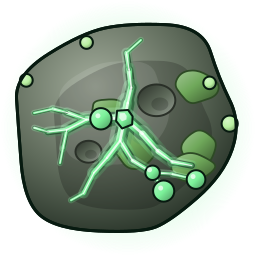 **Rich rocks.** Lit from inside by the world's resource.
- 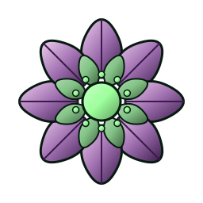 **Spore flowers.** They float in the background, the nebula's own plants.
- 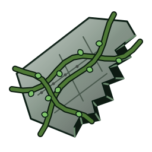 **Wrecks.** Ships the vines are slowly taking over.
- 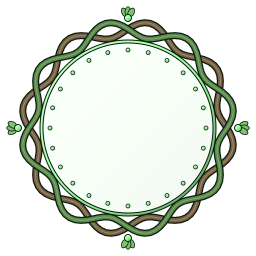 **Portals.** Pairs of gates across a wide map.
- 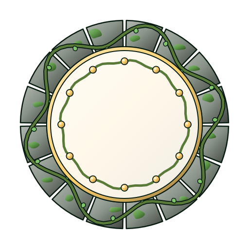 **World gates.** The way on.

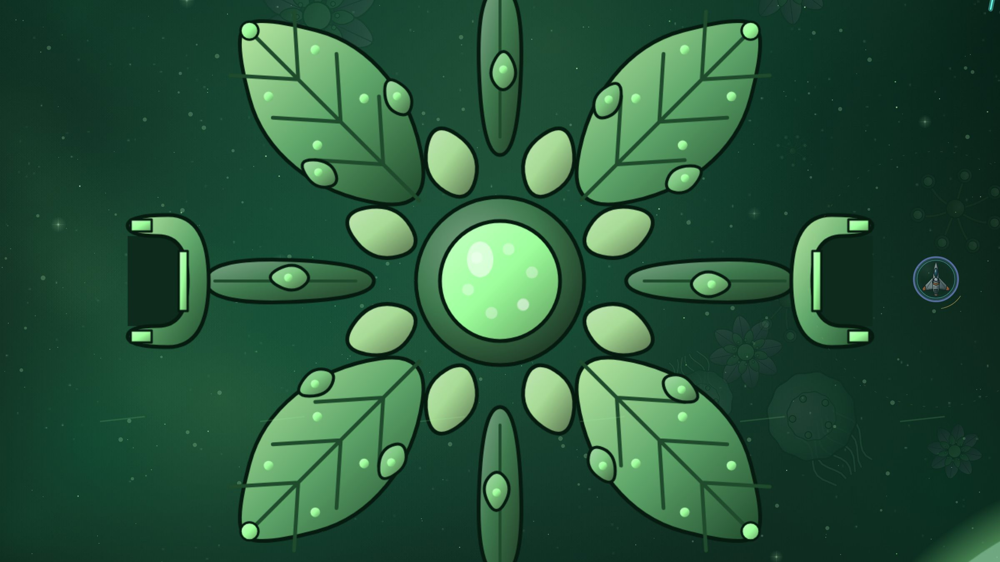

## Who you fight

- 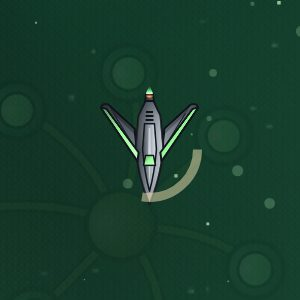 **Raider.** Quick and close.
- 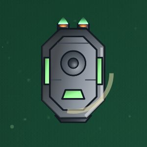 **Tank.** Slow and heavily armoured.
- 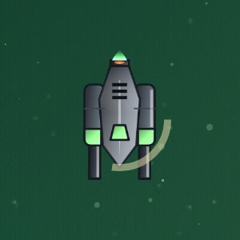 **Gunner.** Sprays scatter shot from range.
-  **Splitter.** Hit it and it breaks into small, fast shards.
- 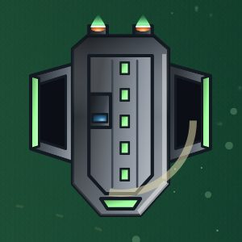 **Carrier.** In the arcade: it hangs back and launches drones. Kill the carrier and the drones fall with it.
- 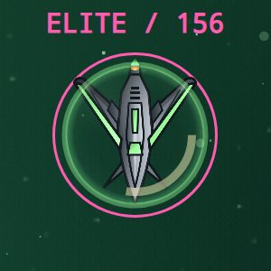 **Elite.** Verdant's elites sow spore mines around themselves.

## The flagship: the Thorn Beetle

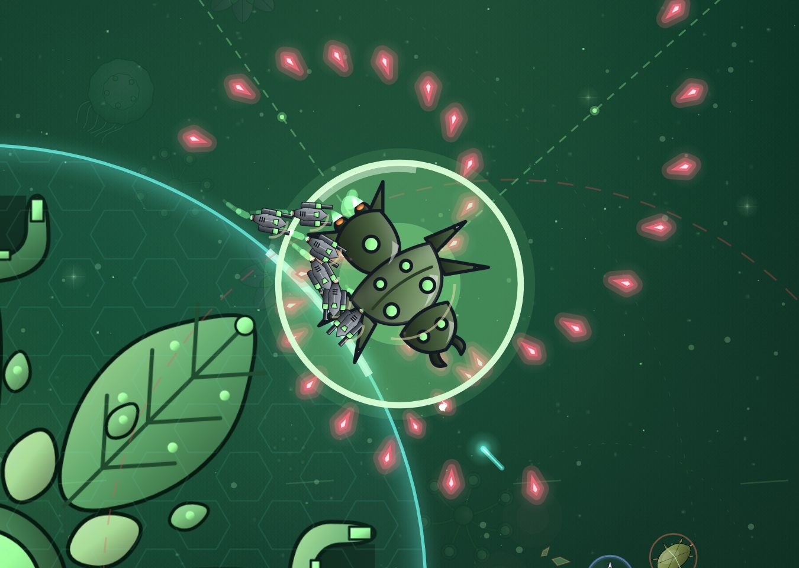

A huge beetle with glowing eyes and a back full of spines. It drifts with
the current like everything here and scatters spores that drift too, so the
danger keeps moving. Once it is half broken it starts hatching a brood of
small raiders.

In the arcade, nests shield the beetle. Break the nests first, then turn
your guns on the beetle itself.

## Before you go

Long flights through the currents are easier with Slipstream and repair
nanites. Fight near rocks you can see coming: the current moves them too.
