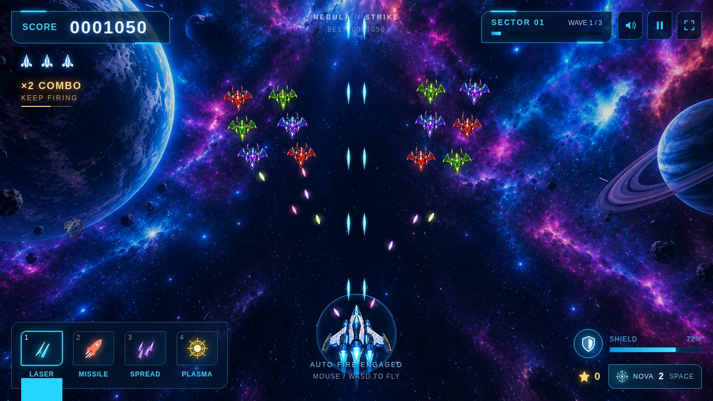

# Prototypes

Earlier prototypes, kept for history as they were. Each is one HTML file
that plays offline: open it in a browser. Nothing here is built, linted or
loaded by the game.

## Nebula Strike (2026-10-19)

[nebula-strike.html](nebula-strike.html), 6.9 MB: a vertical arcade
shooter in one file. Three sectors of three waves, a dreadnought at the
end of each; four weapons (laser, homing missile, spread, piercing
plasma) on keys 1 to 4, auto-fire, a screen-clearing nova on Space, gold
stars that upgrade the guns. Flown with the mouse, WASD or the arrows, or
by dragging on a touchscreen. The pictures are in the file as base64 PNG.

